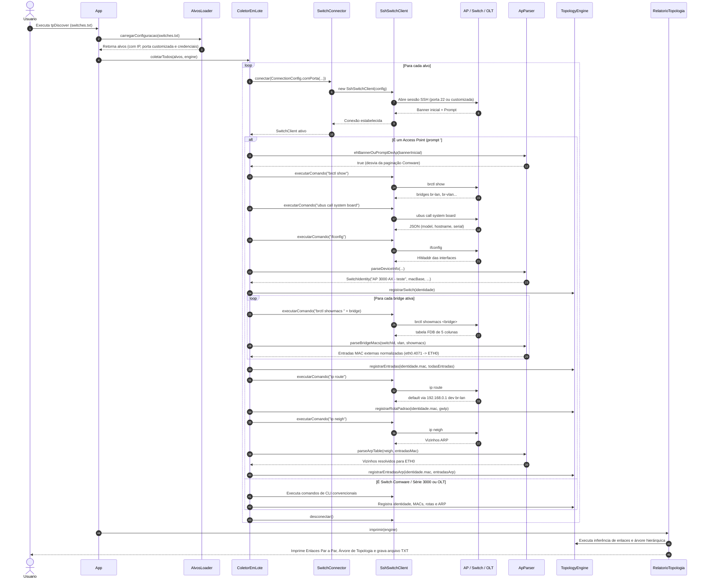

# Arquitetura e Diagramas UML — `tpDiscover`

Documentação arquitetural do projeto **`tpDiscover.intelbras`** (Java 25 CLI / Gradle), refletindo a versão atual com suporte a Switches Comware, Switches Série 3000, OLTs GPON/EPON e Access Points corporativos Intelbras (linha legado / ZeusOS / OpenWrt).

---

## 1. Visão Geral das Mudanças Recentes

1. **Parser de Access Points Corporativos ([`ApParser.java`](file:///C:/Users/hi062467/Downloads/Utilitários/tpDiscover/app/src/main/java/tpDiscover/intelbras/parser/ApParser.java))**:
   - Detecção antecipada via prompt/banner (`#`, `>`, Dropbear, OpenWrt), evitando o envio de `screen-length disable` do Comware que travaria a CLI restrita `klish`.
   - Extração de modelo e hostname via `ubus call system board` e MAC-base físico via `ifconfig` (`br-lan`/`eth0`).
   - Coleta de tabelas MAC via `brctl show` e `brctl showmacs <bridge>`, filtrando apenas MACs externos (`is local? == no`).
   - Mapeamento de subinterfaces VLAN (ex.: `eth0.4071`) para a porta física `ETH0` com anotação do `vlanId`, prevenindo falsos loops ou detecção errônea de múltiplos cabos.
   - Resolução de vizinhos ARP L3 (`ip neigh`) para portas físicas reais cruzando com a tabela da bridge.
2. **Suporte a Portas Customizadas e Credenciais**:
   - `SwitchTarget`, `AlvosLoader` e `ConnectionConfig` agora suportam alvos no formato `ip:porta;usuario;senha` (ex.: `10.1.31.19:65019;admin;...`).
   - Suporte a ponto-e-vírgula em senhas e senha interativa em memória para alvos sem senha em disco.
   - Mascaramento de senhas em logs e `SwitchTarget.toString()`.
3. **Resiliência em Terminais e Shells Restritos**:
   - Regex de prompt em `SshSwitchClient` e `TelnetSwitchClient` expandida para capturar `#` puro e `user@host:~#`.
   - Recuperação automática enviando `Ctrl-U` (`\u0015\n`) ao detectar `Syntax error: Illegal command line` na CLI `klish`.
4. **Proteção contra Colisões e NullPointerException**:
   - `MacUtils.ehMacValido` valida MACs de 48 bits (rejeitando nulos, zeros e broadcasts).
   - `SwitchIdentity.macNormalizado` gera identificador sintético determinístico (`sem-mac@<ip>`) quando o MAC-base não estiver disponível.
5. **Correlação de Topologia**:
   - `TopologyEngine` e `RelatorioTopologia` correlacionam o MAC do AP com as portas do switch pai, apresentando o enlace direto (`Switch [GE1/0/10] <-> [ETH0] AP 3000 AX - teste`) e na árvore hierárquica.
6. **Exportação Executiva em PDF Vetorial ([`ExportadorPlanejadorRede.java`](file:///C:/Users/hi062467/Downloads/Utilitários/tpDiscover/app/src/main/java/tpDiscover/intelbras/correlacao/ExportadorPlanejadorRede.java))**:
   - Integração visual inspirada no *Planejador de Rede* da Intelbras.
   - Geração de documento PDF em formato A4 Paisagem executivo via navegador headless (Edge/Chrome).
   - Renderização de diagrama de rede vetorial SVG dinâmico (ícones 3D, cabos de fibra/cobre, badges de portas e LEDs de status).
   - Tabelas executivas de enlaces par a par, inventário de dispositivos e tabela de clientes ARP com resolução de fabricantes IEEE OUI.
   - Limpeza automática de arquivos intermediários, gerando exclusivamente o arquivo `topologia_AAAA-MM-DD_HHmm.pdf`.

---

## 2. Diagrama de Classes UML (Class Diagram)

```mermaid
classDiagram
    direction TB

    namespace tpDiscover_intelbras {
        class App {
            +main(String[] args)$ void
        }
    }

    namespace tpDiscover_intelbras_coleta {
        class AlvosLoader {
            +carregarDeArquivo(Path caminho)$ List~SwitchTarget~
            +carregarConfiguracao(Path caminho)$ ConfiguracaoAlvos
        }
        class ConfiguracaoAlvos {
            <<record>>
            +List~SwitchTarget~ alvos
            +String gatewayIpManual
            +String gatewayMacManual
            +possuiGatewayManual() boolean
        }
        class SwitchTarget {
            <<record>>
            +String ip
            +String usuario
            +String senha
            +Integer portaCustomizada
            +possuiSenha() boolean
            +comSenha(String novaSenha) SwitchTarget
            +enderecoExibicao() String
            +toString() String
        }
        class ColetorEmLote {
            -ComwareParser comwareParser
            -Serie3000Parser serie3000Parser
            -OltParser oltParser
            -ApParser apParser
            +coletarTodos(List~SwitchTarget~ alvos, TopologyEngine engine) ResultadoColeta
            -coletarEquipamento(SwitchTarget alvo, TopologyEngine engine) void
            -tentarColetarAp(String ip, SwitchClient cliente, TopologyEngine engine) Optional~SwitchIdentity~
        }
        class ResultadoColeta {
            <<record>>
            +List~SwitchIdentity~ sucesso
            +List~FalhaColeta~ falhas
            +total() int
        }
        class FalhaColeta {
            <<record>>
            +SwitchTarget alvo
            +Tipo tipo
            +String mensagem
        }
        class LocalGatewayDetector {
            +detectarGatewayLocalNaMesmaSubRede(Collection~String~ ipsSwitches)$ Optional~GatewayInfo~
        }
    }

    namespace tpDiscover_intelbras_connection {
        class ConnectionConfig {
            <<record>>
            +String ip
            +String usuario
            +String senha
            +int portaSsh
            +int portaTelnet
            +long timeoutMillis
            +padrao(String ip, String usuario, String senha)$ ConnectionConfig
            +comPorta(String ip, String usuario, String senha, Integer portaCustomizada)$ ConnectionConfig
        }
        class SwitchConnector {
            +conectar(ConnectionConfig config)$ SwitchClient
        }
        class SwitchClient {
            <<interface>>
            +connect() void
            +executarComando(String comando) String
            +desconectar() void
            +bannerInicial() String
        }
        class SshSwitchClient {
            -ConnectionConfig config
            -Session session
            -ChannelShell channel
            -InputStream in
            -OutputStream out
            -String bannerInicial
            +connect() void
            +executarComando(String comando) String
            +desconectar() void
            +bannerInicial() String
        }
        class TelnetSwitchClient {
            -ConnectionConfig config
            -TelnetClient client
            -InputStream in
            -PrintStream out
            -String bannerInicial
            +connect() void
            +executarComando(String comando) String
            +desconectar() void
            +bannerInicial() String
        }
        class SwitchConnectionException {
            -Tipo tipo
            +getTipo() Tipo
        }
        class Tipo {
            <<enumeration>>
            FALHA_AUTENTICACAO
            TIMEOUT
            INALCANCAVEL
            ERRO_PROTOCOLO
        }
    }

    namespace tpDiscover_intelbras_parser {
        class ComwareParser {
            +parseDeviceInfo(String ip, String displayDeviceManuinfo) SwitchIdentity
            +parseMacTable(String switchId, String displayMacAddress) List~MacEntry~
            +parseArpTable(String displayArp) List~ArpEntry~
            +parseDefaultGatewayIp(String displayIpRoutingTable) Optional~String~
        }
        class Serie3000Parser {
            +parseDeviceInfo(String ip, String showVersion, String showSystem, String showInterfaceVlan1) SwitchIdentity
            +parseMacTable(String switchId, String showMacAddressAll) List~MacEntry~
            +parseArpTable(String showArp) List~ArpEntry~
            +parseDefaultGatewayIp(String showIpRoute) Optional~String~
            +formatarMacPadrao(String rawMac)$ String
        }
        class OltParser {
            +parseDeviceInfo(String ip, String showSystem, String showCard) SwitchIdentity
            +parseMacTable(String switchId, String showMac) List~MacEntry~
            +parseArpTable(String showArp) List~ArpEntry~
            +parseDefaultGatewayIp(String showRoute) Optional~String~
        }
        class ApParser {
            +ehBannerOuPromptDeAp(String bannerInicial) boolean
            +ehDispositivoAp(String ubusBoard, String brctlShow, String ifconfig) boolean
            +parseDeviceInfo(String ip, String ubusBoard, String ifconfig, String brctlShow) SwitchIdentity
            +parseBridgesEVlans(String brctlShowOutput) Map~String, Integer~
            +parseBridgeMacs(String switchId, int defaultVlan, String brctlShowmacsOutput) List~MacEntry~
            +parseDefaultGatewayIp(String rawIpRoute) Optional~String~
            +parseArpTable(String rawIpNeigh, List~MacEntry~ entradasMacBridge) List~ArpEntry~
            +normalizarPortaAp(String interfaceBruta)$ String
        }
    }

    namespace tpDiscover_intelbras_modelos {
        class SwitchIdentity {
            <<record>>
            +String deviceName
            +String serialNumber
            +String macAddress
            +String productId
            +String ip
            +possuiMacValido() boolean
            +macNormalizado() String
        }
        class MacEntry {
            <<record>>
            +String switchId
            +String mac
            +int vlanId
            +String state
            +String port
            +macNormalizado() String
        }
        class ArpEntry {
            <<record>>
            +String ip
            +String mac
            +String port
            +macNormalizado() String
        }
        class GatewayInfo {
            <<record>>
            +String ip
            +String mac
            +macNormalizado() String
            +rotuloVisual() String
        }
        class MacUtils {
            +normalizar(String mac)$ String
            +prefixo(String macNormalizado)$ String
            +paraLong(String macNormalizado)$ long
            +ehMacValido(String macNormalizado)$ boolean
            +pertenceAoSwitch(String macBase, String macObservado)$ boolean
        }
        class OuiLookup {
            +obterFabricante(String mac)$ String
            +formatar(String mac)$ String
        }
    }

    namespace tpDiscover_intelbras_dados {
        class SwitchDataRepository {
            -List~MacEntry~ todasEntradas
            -Map~String, SwitchIdentity~ switches
            -Map~String, Map~String, Set~String~~~ macsPorPorta
            +registrarSwitch(SwitchIdentity identidade) void
            +registrarEntradasMac(List~MacEntry~ entradas) void
            +identificarSeEhSwitch(String macNormalizado) Optional~SwitchIdentity~
        }
    }

    namespace tpDiscover_intelbras_correlacao {
        class TopologyEngine {
            -Map~String, SwitchIdentity~ switchesPorId
            -Map~String, List~MacEntry~~ entradasPorSwitch
            -Map~String, String~ rotaPadraoPorSwitch
            -Map~String, List~ArpEntry~~ arpPorSwitch
            +registrarSwitch(SwitchIdentity identidade) void
            +registrarEntradas(String switchId, List~MacEntry~ entradas) void
            +registrarRotaPadrao(String switchId, String gatewayIp) void
            +registrarEntradasArp(String switchId, List~ArpEntry~ entradasArp) void
            +definirGatewayManual(String ip, String mac) void
            +identificarConexaoGateway() Optional~ConexaoGateway~
            +obterTopologiaParAPar() List
            +construirArvoreHierarquica() ArvoreTopologia
        }
        class RelatorioTopologia {
            +imprimir(TopologyEngine engine)$ void
            +imprimir(TopologyEngine engine, Path pastaDestino)$ void
            +gerarRelatorioTexto(TopologyEngine engine)$ String
        }
        class ExportadorPlanejadorRede {
            +exportarPdf(TopologyEngine engine, Path pastaDestino)$ Optional~Path~
            -construirHtmlCompleto(TopologyEngine engine)$ String
            -gerarSvgTopologia(TopologyEngine engine)$ String
            -renderizarPdfComNavegador(Path arquivoHtml, Path arquivoPdf)$ boolean
        }
    }

    %% Relacionamentos
    App --> AlvosLoader : carrega alvos
    App --> LocalGatewayDetector : detecta gateway local
    App --> ColetorEmLote : orquestra
    App --> TopologyEngine : inicializa
    App --> RelatorioTopologia : exibe resultados

    AlvosLoader *-- SwitchTarget : cria
    AlvosLoader *-- ConfiguracaoAlvos : retorna

    ColetorEmLote --> SwitchConnector : conecta
    ColetorEmLote --> ConnectionConfig : cria configuracao
    ColetorEmLote o-- ComwareParser : usa
    ColetorEmLote o-- Serie3000Parser : usa
    ColetorEmLote o-- OltParser : usa
    ColetorEmLote o-- ApParser : usa
    ColetorEmLote --> TopologyEngine : popula dados
    ColetorEmLote *-- ResultadoColeta : gera
    ResultadoColeta *-- FalhaColeta : contem

    SwitchConnector ..> SwitchClient : instancia
    SwitchConnector ..> SshSwitchClient : instancia
    SwitchConnector ..> TelnetSwitchClient : instancia
    SwitchConnector ..> ConnectionConfig : recebe

    SwitchClient <|.. SshSwitchClient : implementa
    SwitchClient <|.. TelnetSwitchClient : implementa
    SwitchClient ..> SwitchConnectionException : lanca
    SwitchConnectionException *-- Tipo : possui

    ComwareParser ..> SwitchIdentity : cria
    ComwareParser ..> MacEntry : cria
    ComwareParser ..> ArpEntry : cria

    Serie3000Parser ..> SwitchIdentity : cria
    Serie3000Parser ..> MacEntry : cria
    Serie3000Parser ..> ArpEntry : cria

    OltParser ..> SwitchIdentity : cria
    OltParser ..> MacEntry : cria
    OltParser ..> ArpEntry : cria

    ApParser ..> SwitchIdentity : cria
    ApParser ..> MacEntry : cria
    ApParser ..> ArpEntry : cria

    TopologyEngine o-- SwitchIdentity : gerencia
    TopologyEngine o-- MacEntry : analisa
    TopologyEngine o-- ArpEntry : correlaciona
    TopologyEngine o-- GatewayInfo : associa
    TopologyEngine ..> MacUtils : compara MACs
    TopologyEngine ..> LocalGatewayDetector : consulta fallback

    RelatorioTopologia ..> TopologyEngine : le estado
    RelatorioTopologia ..> OuiLookup : consulta fabricantes
    RelatorioTopologia --> ExportadorPlanejadorRede : delega geracao de PDF
    ExportadorPlanejadorRede ..> TopologyEngine : le topologia e clientes
    ExportadorPlanejadorRede ..> OuiLookup : resolve fabricante por OUI
    GatewayInfo ..> OuiLookup : formata rotulo
    SwitchIdentity ..> MacUtils : normaliza MAC
```



---

## 3. Diagrama de Pacotes e Componentes

```mermaid
flowchart TD
    subgraph UI_CLI["Camada de Entrada (CLI)"]
        APP["App.java\n(Ponto de Entrada e Orquestração)"]
    end

    subgraph COLETA["Camada de Coleta & Descoberta"]
        LOADER["AlvosLoader.java\n(Parse de switches.txt com ip:porta e senhas)"]
        TARGET["SwitchTarget.java\n(Alvo com IP, porta e credenciais)"]
        LOCAL_GW["LocalGatewayDetector.java\n(Fallback de gateway local na mesma subnet)"]
        BATCH["ColetorEmLote.java\n(Orquestrador sequencial de conexões e sondagens)"]
    end

    subgraph CONEXAO["Camada de Conexão (SSH / Telnet)"]
        CONNECTOR["SwitchConnector.java\n(Fallback SSH -> Telnet)"]
        CONFIG["ConnectionConfig.java\n(Suporte a porta customizada)"]
        CLIENT["SwitchClient (Interface)\n(connect, executarComando, bannerInicial)"]
        SSH["SshSwitchClient.java\n(JSch Shell PTY, klish Ctrl-U, regex)"]
        TELNET["TelnetSwitchClient.java\n(Commons Net, login prompt, banners)"]
    end

    subgraph PARSERS["Camada de Parsers Especializados"]
        AP_P["ApParser.java\n(ubus, brctl showmacs, ifconfig, ip neigh/route)"]
        S30_P["Serie3000Parser.java\n(show version, show mac-address all)"]
        COM_P["ComwareParser.java\n(display device manuinfo, display mac-address)"]
        OLT_P["OltParser.java\n(show system, show mac, show arp)"]
    end

    subgraph MODELOS["Camada de Modelos & Domínio"]
        SW_ID["SwitchIdentity.java\n(Fallback determinístico sem-mac@ip)"]
        MAC_E["MacEntry.java\n(Registro L2 vlan, port, mac)"]
        ARP_E["ArpEntry.java\n(Mapeamento L3 IP <-> MAC)"]
        GW_INFO["GatewayInfo.java\n(Rótulo visual com OUI)"]
        MAC_U["MacUtils.java\n(Validação 48-bit, offsets de portas)"]
        OUI["OuiLookup.java\n(Base de fabricantes)"]
    end

    subgraph CORRELACAO["Camada de Correlação & Relatório"]
        ENGINE["TopologyEngine.java\n(Algoritmo L2/L3, Split-Horizon, árvores)"]
        RELATORIO["RelatorioTopologia.java\n(ASCII tree no terminal)"]
        EXPORT_PDF["ExportadorPlanejadorRede.java\n(Layout Executivo A4 Paisagem, SVG vetorial e PDF headless)"]
    end

    APP --> LOADER
    APP --> LOCAL_GW
    APP --> BATCH
    APP --> ENGINE
    APP --> RELATORIO
    RELATORIO --> EXPORT_PDF
    EXPORT_PDF --> ENGINE
    EXPORT_PDF --> OUI

    LOADER --> TARGET
    BATCH --> CONNECTOR
    BATCH --> CONFIG
    CONNECTOR --> CLIENT
    CLIENT <|.. SSH
    CLIENT <|.. TELNET

    BATCH --> AP_P
    BATCH --> S30_P
    BATCH --> COM_P
    BATCH --> OLT_P

    AP_P & S30_P & COM_P & OLT_P --> SW_ID
    AP_P & S30_P & COM_P & OLT_P --> MAC_E
    AP_P & S30_P & COM_P & OLT_P --> ARP_E

    BATCH --> ENGINE
    ENGINE --> SW_ID
    ENGINE --> MAC_E
    ENGINE --> ARP_E
    ENGINE --> GW_INFO
    ENGINE --> MAC_U

    RELATORIO --> ENGINE
    RELATORIO --> OUI
```

---

## 4. Diagrama de Sequência de Coleta


